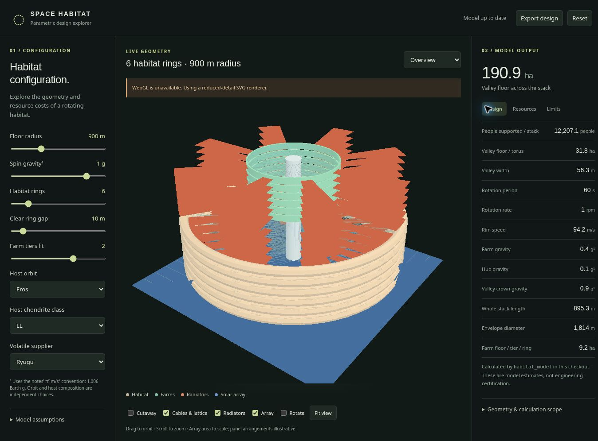

# Habitat explorer

Local 3D interface to `habitat_model`. Uses Three.js for rendering and the existing Python calculations for all reported quantities. No formulas are reimplemented in JavaScript.

From the repository root, with Python 3.11+ and Node/npm installed:

```sh
pip install -r requirements.txt
npm ci --prefix explorer
python explorer/server.py
```

Open http://127.0.0.1:8000. The server binds to loopback by default. It is a local development tool, not a hardened public service. It needs no external services after installation.

Change the radius, spin gravity, number of rings, clear gap, lit farm tiers, host orbit, assumed chondrite class or volatile supplier. Expand **Model assumptions** for width, shielding, fill, pressure, farm radiator reach and factory power. Orbit and composition are independent. The available bodies are those supported by `habitat_model.design`, not the entire research catalogue.

WebGL is used when available; a reduced-detail SVG fallback works without it.

Drag to orbit, scroll to zoom, or choose an axial, side or tube-section view. **Fit view** reframes after changing size. Rotation uses the calculated rate in real time; the solar array stays despun. Turn off the array to inspect the stack more closely. **Load design** reopens an exported JSON file and recalculates it against the current model; saved results are never trusted as inputs. JSON export includes the evaluated inputs, results and assumption sources/statuses. It exports the last successfully evaluated design only; exports are disabled while changes are pending or invalid.

## Scope

- All dimensions and numbers come from the Python system model. Radius, gravity and period remain dependent. The notes' gravity unit is π² m/s², approximately 1.006 Earth g.
- The six-ring, 900 m, two-lit-tier, Eros/LL/Ryugu preset is an exploration starting point.
- Valley envelopes use toroidal circular sections. Farm envelopes have rectangular sections, axial width and radial height. The two sections share a hub.
- Cutaways show the pressure boundary, nominal rock jacket, crawl-space boundary and a schematic floor. The uniform drawn jacket does not show the floor-fill shielding credit used in the mass calculation. There is no terrain or detailed room layout.
- Two tangent-chord side nets, hub lines, farm spokes and rim-gap X braces illustrate the structural architecture. Counts are reduced for clarity; sizes, exact anchor positions and fittings are not engineering drawings. No detailed structural solve runs in the viewer.
- Solar area is the per-torus aphelion-sized system-model array multiplied by ring count, drawn as one square beyond the hub. This placement is illustrative. The factory's power supply is not included in that array.
- Radiator sectors show available radial reach only. They are not sized to the heat load. The reported panel area is a black-body, two-sided lower bound, not the rendered sectors' area or a mutually shaded thermal solution.
- Torus mass excludes the separately reported farm and the hub/factory, array and radiators. No incomplete sum is labelled total stack mass.
- Stability outputs are **rigid thin-ring inertia bounds**, not flexible whirl margins. The favourable baseline depends on the lattice in the detailed dynamics work. Heat margin is the **main drum's ideal end-aperture bound**, not assembled radiative exchange.
- Shield density changes geometry and mass, not a newly calculated radiation dose. Replication uses the existing simplified electric-propulsion energy model, not the finite-thrust fleet scheduler. Unknown routes remain unknown.
- UI ranges bound exploration and API inputs; they do not define a physically validated domain. Assumption provenance appears beside advanced inputs and in exports. Compare detailed reports before drawing feasibility conclusions.

## Checks

```sh
node --check explorer/app.js
python -m unittest discover -s tests -p 'test_explorer.py'
```


