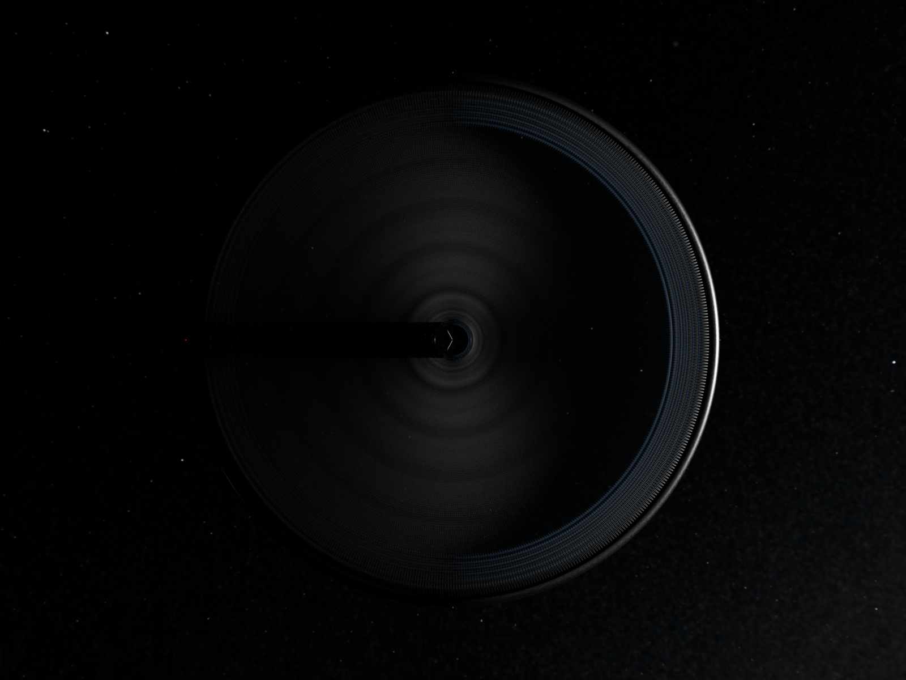
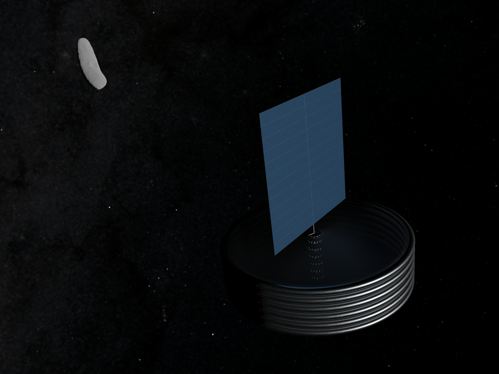
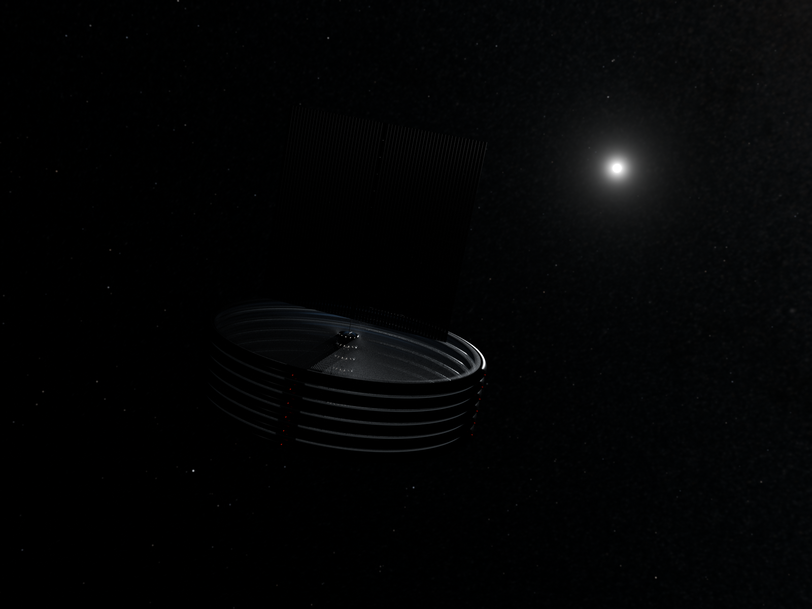
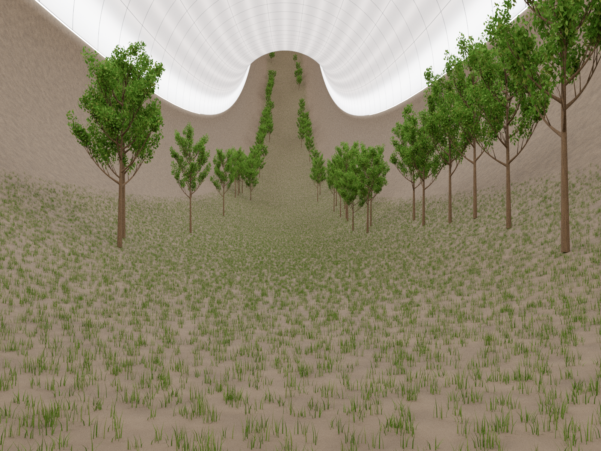

# Blender rendering choices

This note records the visual additions in `space-habitat-900m.blend`, separately from the numerical habitat model. It describes the six-torus scene prepared on 3 November 2026, with perihelion lighting updated on 4 November. The [browser explorer](../explorer/README.md) is a separate visualization.

The Blender file is maintained manually. Editing it does not update the calculations, and changes to the calculations do not automatically update the scene.

See [TODO.md](TODO.md) for the planned grass and tree improvements.

## Open the scene

Open [space-habitat-900m.blend](space-habitat-900m.blend) in Blender 5.2.3 or newer. Paths in the table below are relative to this directory.

| File | Purpose | Size | Stored in Git |
| --- | --- | --- | --- |
| `space-habitat-900m.blend` | Editable habitat scene | 37.6 MiB | Yes |
| `assets/eros.blend` | Linked Eros mesh | 4.34 MiB | Yes |
| `assets/sky.exr` | Generated sky texture | 114.1 MiB | No |

The main scene loads Eros from `//assets/eros.blend` and the sky from `//assets/sky.exr`. Keep this folder layout. The Eros object, transforms and material remain editable in the main scene; only its mesh is linked. Keep **Automatically Pack Resources** disabled so the assets stay separate.

A fresh checkout contains the scene and Eros mesh. Generate the missing sky before rendering. From the repository root, using Python 3.11 or newer:

```sh
python -m venv rendering/.venv
source rendering/.venv/bin/activate
python -m pip install -r rendering/requirements.txt
python rendering/generate_sky.py
```

This writes `rendering/assets/sky.exr` and its generated manifest, `rendering/assets/sky.json`. See [sky.md](sky.md) for dependencies, regeneration and reloading instructions, source credits and licences. The EXR exceeds GitHub's 100 MiB per-file limit and is excluded from Git, along with the downloaded generator inputs.

For an existing checkout, move the texture from `rendering/output/habitat-sky.exr` to `rendering/assets/sky.exr`. In Blender, open the World Environment Texture node, load the moved image and save its path as `//assets/sky.exr`. Once the image is moved, delete the old `.part0*` download fragments and the unused `rendering/output/` directory.

## Render the views

The four images below were rendered at **1600 × 1200**, using **Cycles on the GPU with 4096 samples**. Set **Output Properties > Resolution** to 1600 × 1200 at 100%, **Render Properties > Device** to GPU Compute, and the render maximum samples to 4096. Select a compatible compute backend and GPU in Blender's **Preferences > System > Cycles Render Devices**; this selection depends on the local machine.

The scene saves these resolution, GPU Compute and sampling settings. The compute backend and physical GPU selection remain local Blender preferences.

Select the camera in **Scene Properties > Camera**. Camera object names in the Outliner differ from their camera-data names; use the object names below.

| View | Camera object | Exposure |
| --- | --- | --- |
| Dock end, on the spin axis | `Camera - bottom` | −5.5 stops |
| Eros background | `Camera - Orion` | −5.5 stops |
| Sun background | `Camera - Sun` | −5.5 stops |
| Valley interior | `Camera - interior` | 0 stops |
| Additional exterior overview | `Camera - exterior` | −5.5 stops |

Set **Render Properties > Color Management > Exposure** explicitly when changing between exterior and interior views; the shared scene exposure is not a separate saved value for each camera. Keep AgX colour management and World Strength 5. Render with **F12** and save the result as PNG using the filenames below. There is one scene; switching views does not require duplicating it.

### Exterior, dock side



### Exterior, Eros view



### Exterior, Sun view



### Interior valley



## What comes from the model

The scene uses a 900 m habitat floor radius, a 56.25 m torus tube diameter, a 5.5 m rock jacket and a 60.75 m hub radius. The pressure shell, shielding and cable nets follow the model's geometry and structural concept. Individual meshes may lag subsequent structural revisions.

Six tori and no farm rings are the selected configuration. The torus array leaves about 10 m between outer skins. Its 80.274 m pitch includes rendered skin thicknesses; the idealized model pitch is 80.25 m.

The solar collecting area comes from [power.py](../habitat_model/power.py) and the [model assumptions](../habitat_model/assumptions.toml), evaluated at commit [feb36fd](https://github.com/vinc/space-habitat/commit/feb36fd0d105c47ebc1a326653dcc655a2c60f1f):

| Sizing input | Scene configuration |
| --- | --- |
| Habitat | Six tori, 900 m floor radius |
| Site | Eros, using sunlight at aphelion, about 1.7812 AU |
| Valley lighting | Default seasonal sky setting |
| Farms | No farm tiers or farm load |
| Active collecting aperture | 1,476,633 m², about 1.477 km² |

This covers the modeled valley lighting and other habitat loads. Factory demand and the exterior lights added for the render are excluded. The area counts the aperture once, even though the rendered array has active surfaces on both faces.

Changing the number of tori in Blender does not recalculate the solar array.

## Additions made for the image

| Addition | Visual choices and their scope |
| --- | --- |
| Steel surface | Small sheets, seams, brushing, waviness and roughness make the exterior read as stainless steel. Their layout and optical properties are appearance choices, without a manufacturing design or measured material data. |
| Solar surface | Blue colour variation distinguishes modules approximately 1 × 2.01 m, aligned with their support sections. The colours do not encode efficiency, temperature or damage. |
| Soil and grass | Soil texture, grass colour and blades illustrate a planted valley. Detailed blades are concentrated near the interior camera. Grass fades out on slopes around 35–40°. |
| Trees | Instanced tree variants form two forest bands, with open space in the middle and no trees on slopes over roughly 30°. Placement, density and individual appearance are scenery choices. These meshes do not calculate biomass, water demand or maintenance. |
| Interior light fittings | The ceiling diffuser, reflector, frames and light pipes illustrate a possible arrangement. Their shader brightness has not been calibrated to the model's plant-light target or to a demonstrated uniform light distribution. |
| Exterior light fittings | Four red rim beacons per torus mark its position; white hub lamps remain. The rim surface wash is disabled. The fittings and their render power have no corresponding mass, electrical or heat budget added to the numerical model. |
| Cable connections | Cable paths illustrate the structural concept. Contacts with the rim and hub are idealized; engineered anchors, terminations and crossings remain to be designed. |

The numerical study may contain general allowances for vegetation and equipment. Detailed scenery does not refine those allowances.

### Solar bands and supports

The calculated aperture is divided into 60 bands, each 20 m wide, with 1 m gaps. Each band contains 12 sections, approximately 20 × 102.54 m, separated by another 1 m gap. The footprint is approximately 1,259 × 1,241.53 m. Gaps are real openings and do not count as collecting area.

The band arrangement, rails, perimeter frame, hollow mast and open hub mount are schematic additions. Their dimensions have not been derived from deployment, strength, vibration or attitude-control calculations. Their detailed mass has not been checked against the model's generic solar-array mass allowance.

## Lighting and surroundings

### Sun and exposure

The scene uses the geometric Sun direction at **Eros perihelion on
22 November 2027, about 14:18 TDB**, from [JPL Horizons](https://ssd.jpl.nasa.gov/horizons/).
The stored [solar reference](solar-reference.json) includes the exact
query, state vector and coordinate definitions. Perihelion was located by the
zero crossing of heliocentric position dotted with velocity.

The world frame remains **J2000 ecliptic**, with +X toward the equinox and +Z
toward ecliptic north. The direction toward the Sun is
**(+0.548114170, −0.836396491, −0.003430300)**, or ecliptic longitude
**303.237954°**, latitude **−0.196542°**. The native light, visible disk and
Eros material use this same direction. The Sun object's location only places
its viewport icon; its rotation controls the directional light.

The reference distance is **1.133325423 AU**. Total sunlight scales from
1,361 W/m² at 1 AU to approximately **1,059.62 W/m²**. The RGB render retains
the existing 40.39% visible-band approximation, giving native Sun Strength
**427.9793 W/m²**, with angular diameter **0.470346°** (about 1,693 arcseconds).
A visible disk follows the light's direction and angular size without adding
illumination a second time. This remains an RGB approximation, not a spectral
or thermal simulation.

Select **Sun > Light Data > Custom Properties > Distance (AU)** to change the
reference distance. Native drivers update irradiance and apparent diameter.
The **solar array remains sized for aphelion**, the lower-light sizing case;
changing this lighting reference does not resize it.

### Habitat axis relative to the stars

The [adopted design](../notes.md#orientation-adopted) keeps the spin axis inertially
fixed, perpendicular to the host asteroid's heliocentric orbital plane. For
Eros this is **10.8281° from ecliptic north**, rather than ecliptic north itself.

The **Habitat - inertial attitude** parent aligns the rendered stack's local +Z
with Eros's orbital north, computed as the normalized cross product of its
heliocentric position and velocity. The module definitions and native torus
Array remain in their local construction coordinates. The interior camera
follows the assembly, with its grass-distance reference kept in that local frame.

| End of the habitat | Fixed J2000 sky direction | Constellation |
| --- | --- | --- |
| Array end, local +Z | RA 16h49m22.3s, Dec +59°12′45.5″ | Draco |
| Dock end, local −Z | RA 04h49m22.3s, Dec −59°12′45.5″ | Dorado |

These are directions between stars, without requiring a bright pole star.
The Sun direction lies in the ring plane. The array's local +X normal faces
the Sun at the reference instant; continuous Sun tracking is not animated.
Keeping the axis fixed avoids commanding it to follow the Sun around the orbit;
the model's mass-distribution and disturbance checks remain separate from this
static rendering pose.

Camera exposure, AgX colour management and material roughness substantially affect the result. The supplied exterior camera uses −5.5 stops and the interior camera uses 0. These settings serve the image rather than predicting human visibility.

Artificial light sources are shared for common colour and power controls. The red beacon lens is emissive, with its strength driven by twice the source's Power value and direct lighting disabled. That value controls render visibility; it is not an electrical fixture rating.

### Stars

The sky is one external **8192 × 4096 linear EXR**, combining the original **4000 × 2000** [Gaia EDR3 PNG](https://www.esa.int/var/esa/storage/images/esa_multimedia/images/2020/12/the_colour_of_the_sky_from_gaia_s_early_data_release_32/22358132-1-eng-GB/The_colour_of_the_sky_from_Gaia_s_Early_Data_Release_3.png) with **8,404 Yale Bright Star Catalogue entries through visual magnitude 6.5**. The stars use catalogue positions and magnitude-based flux ratios; there are no random stars. The panorama and stars share a J2000 ecliptic orientation, with +X toward the equinox and +Z toward ecliptic north. The dated solar direction is expressed in this same frame. Proper motion and parallax updates remain omitted.

The Milky Way remains subdued but visible, using `milky_way_gain = 0.4` at the supplied exterior exposure and 0.15° smoothing. The gain is tuned to the original PNG's brightness and adjusted independently of the catalogue stars. The PNG's gamma metadata is decoded before filtering; the 8192 × 4096 output preserves the original map's finer detail without adding detail beyond that source. Gaia shows integrated stellar brightness and dark dust lanes; it does not provide all the nebulosity seen in deep Orion photographs. Absolute visibility, approximate temperature colours and finite star-image profiles are display choices. **Visible sky - camera background only > Strength** controls overall brightness; the supplied value is 5. The sky provides no illumination or reflections. Uniform background fill is zero, and the independent Sun disk and Eros lighting remain separate.

The [generator](generate_sky.py) and editable [recipe](sky.json) reproduce the texture without Blender or `bpy`. See [sky.md](sky.md) for dependencies, controls, loading instructions, source hashes and attribution.

### Manual sky brightness and optional Sun halo

Change **Shading > Shader Editor > World > Visible sky - camera background
only > Strength** directly before rendering. The saved value is **5**.
A value of 2.5 gives half this radiance; 10 gives twice this radiance.
The Milky Way and catalogue stars share this control. Their brightness is a
display choice, without an absolute photometric calibration.

There is no foreground metering or automatic background adjustment. Film
transparency stays off. Saved viewport settings use Scene World, full background
opacity and no environment blur. Use Material Preview or Rendered shading.

The compositor contains only three nodes: **Scene render**, **Sun halo - mute
to disable**, and **Final image**. The Glare node adds a restrained soft halo
around very bright highlights, with a high threshold chosen to isolate the
visible Sun in this scene. Its source is capped to keep the halo bounded.
It is an artistic approximation of lens scatter, without a calibrated lens
model. Select the Glare node and press **M** to disable the effect. It does not
meter or rescale the background.

The compositor requires no Environment or Mist pass. No script or add-on is
needed. Ordinary World Strength editing works independently of the halo.

### Eros

Eros uses the [NEAR/Gaskell shape model](https://doi.org/10.26033/d0gq-9427),
so its overall shape comes from spacecraft data. Its centre is **325 km from
the habitat**, at **X = 0, Y = +325 km, Z = 0**. With the dated Sun direction,
direct sunlight and reflected light from Eros arrive from directions about
**147° apart**. This relative placement is a composition choice, not a propagated
habitat orbit around Eros.

### Orienting Eros without changing its spin pole

The mesh's **local +Z** is its spin pole. The measured pole is approximately
J2000 right ascension **11.3692°**, declination **17.2273°**
([NEAR navigation results](https://ipnpr.jpl.nasa.gov/progress_report/42-152/152F.pdf)).
Converted to this scene's ecliptic frame, one matching **XYZ Euler** orientation
is **X = 0°, Y = 78.65°, Z = 17.24°**.

This is an orientation relative to the stars, not one associated with a particular
date. The world's XY plane is the ecliptic, while the habitat ring is now aligned
with Eros's own orbital plane, inclined by about 10.83°. Eros's spin pole is about
1° above that orbital plane, compared with 11.35° above the ecliptic. These are
compatible measurements in different frames. The habitat has been tilted within
the fixed stellar frame; the sky and Eros's pole have not been rotated.

After aligning the pole, select Eros and press **R → Z → Z**, enter an angle,
and confirm. The second Z selects the object's **local Z axis**, so this changes
the rotational phase while preserving the pole direction. All three displayed
Euler values may change; editing one global Euler field independently is not
equivalent.

The saved crater-facing phase uses XYZ Euler rotation
**(−47.725°, 72.9887°, 328.242°)**. This phase is chosen for the image, without
matching a specific epoch. The pole remains aligned to the star background, and
the Sun now uses the dated perihelion direction described above. Eros's selected
spin phase is still a visual choice, so this is not a fully dated attitude reconstruction.

The material uses an approximate, Sun-dependent Hapke-style reflectance treatment. It has not been validated as a spectral or photometric reconstruction. Blender calculates its reflected light separately from the numerical habitat power and thermal models.

## What the scene leaves out

The scene has no farm rings, factory, radiators or docking facilities. It also omits detailed inter-torus structural connections, pressure tunnels and engineered cable fittings. Repeated hub sleeves alone do not establish a structurally complete six-torus assembly.

Omitting something from the picture does not remove it from the wider design study. Use the [model reports](../reports/) for numerical results.
